# ForeverXIUI 1.4.5

An FFXI-style UI for WoW Forever, inspired by XIUI's look: navy windows with thin steel edges and clean bars, for the player, target, cast bars, party, raid, minimap, menu, EXP bar, bags and more. Everything can be moved, sized and switched off. Not affiliated with XIUI; no XIUI code or art is used.

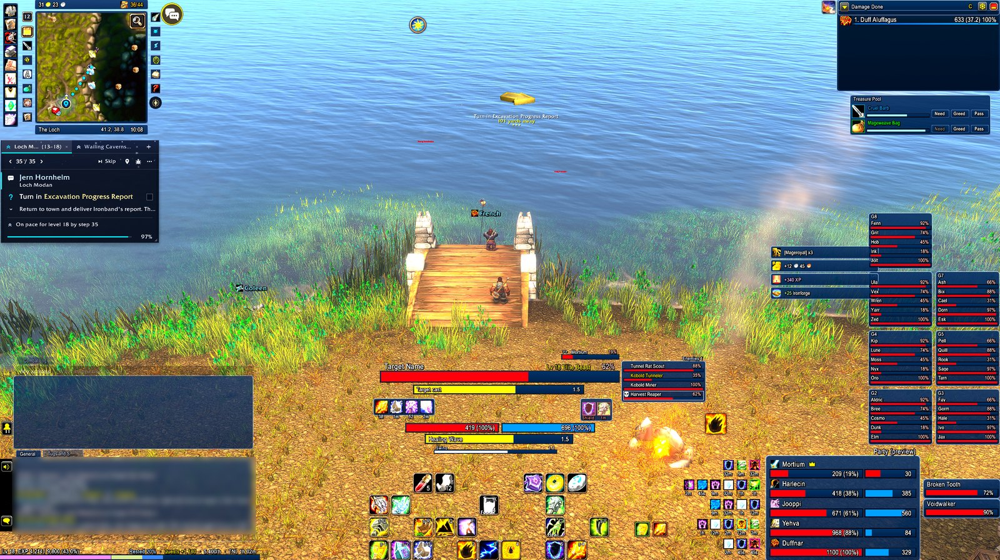

### Target and player
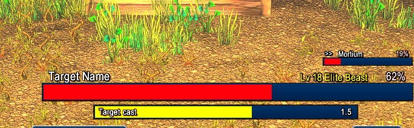

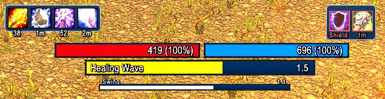

### Party and raid
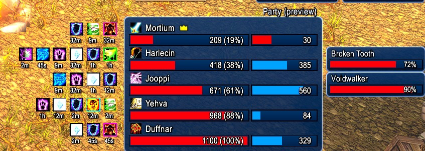

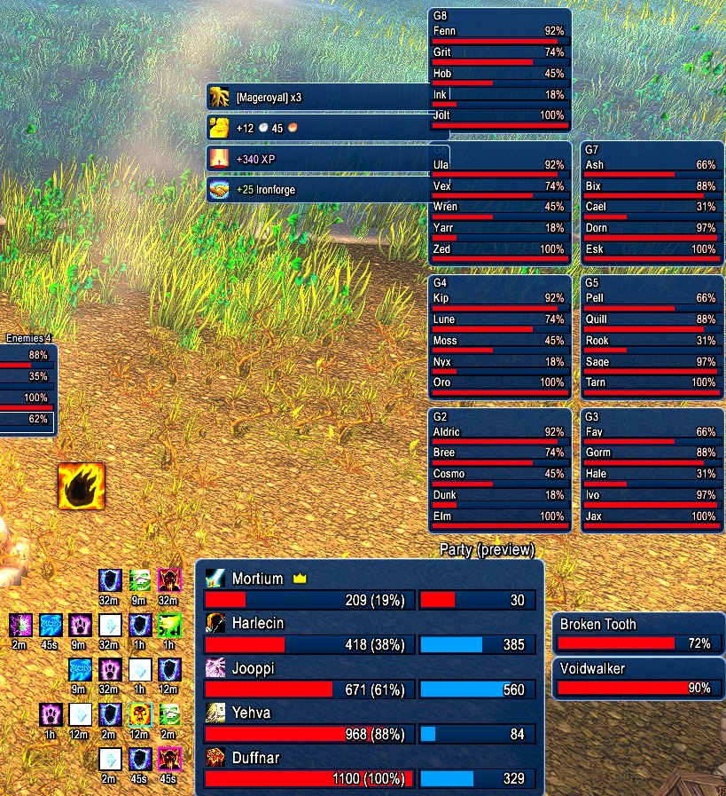

### Minimap, bags and more
| Minimap | Menu column |
|---|---|
| 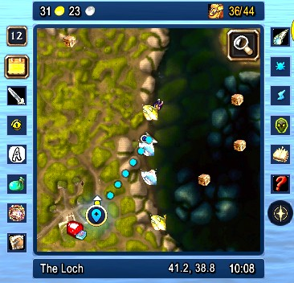 | 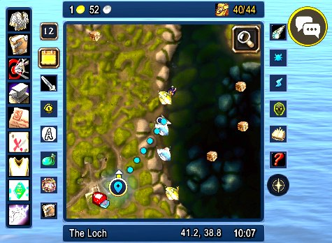 |

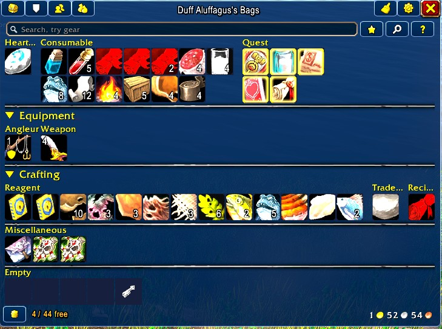

| Damage meter | Treasure pool |
|---|---|
| 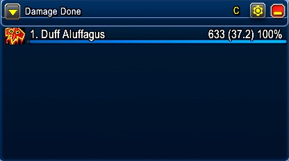 |  |

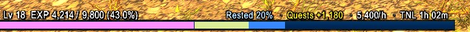

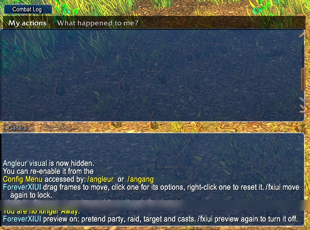

Solo, out of combat:

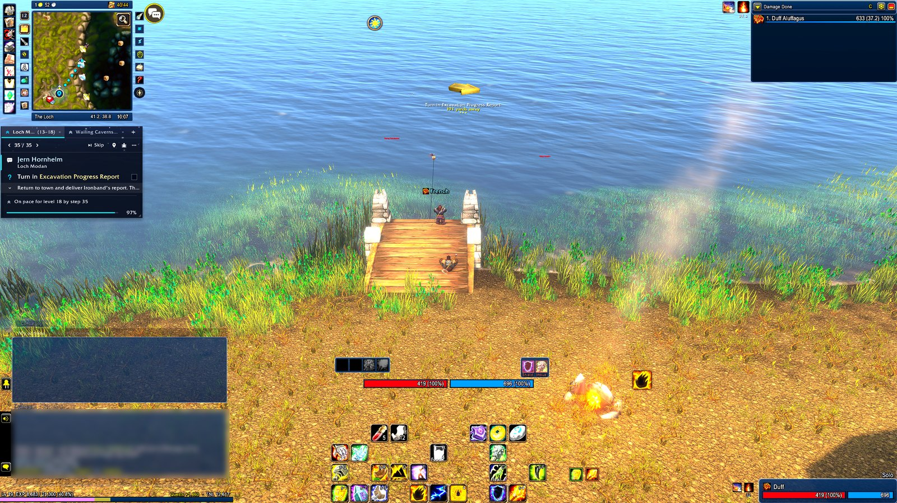

## Features
- **Player and target bars** with XI health, mana and cast bars, target of target, mob info, threat colours and buffs/debuffs.
- **Party list** with pets beside their owners, buff and debuff icons with timers, range fading, and a **raid list** for the other groups.
- **Enemy list** of what you and your group are fighting, and a target cast bar.
- **Minimap** in an XI window, square, with zone, coordinates, clock, gold and bag slots, and every minimap button lined up along its edge.
- **XI menu** column in place of the micro menu, with the buttons you pick.
- **EXP bar** with rested, quest XP ready to hand in, XP per hour and time to level; **notifications** for loot, gold, XP and reputation; a **treasure pool** for group loot rolls.
- **Shaman tools**: totem bar with timers, swing timer, Lightning Shield and weapon imbue reminders.
- **Skins** for the chat windows, the built-in damage meter, Baganator bags and Plater nameplates (or ForeverXIUI's own nameplates).
- **Junk by Auctionator price** with a sell window at vendors that lets you untick anything first.
- **Options window** (`/fxiui`) and **move mode** (`/fxiui move`): drag any frame, click it to jump to its options.
- **Profiles**: save, load and share setups, including your Edit Mode layout. Starts with the built-in "Duff" profile.

## Install
1. Download `ForeverXIUI-<version>.zip` from the latest [release](../../releases/latest).
2. Extract it into `World of Warcraft\_forever_\Interface\AddOns\`, so you have `AddOns\ForeverXIUI\ForeverXIUI.toc`.
3. Start the game. Type `/fxiui` for options. To also get the Duff Edit Mode layout, load the Duff profile from the Profiles page.

Works on its own. Optional extras it skins or reads from: Baganator, Auctionator, Plater, Polestar.

## Commands
- `/fxiui` opens the ForeverXIUI options window (also Esc > Options > AddOns > ForeverXIUI > Open).
- `/fxiui move` lets you drag every frame. It also turns on while Edit Mode is open. Click a frame (without dragging) to open its options, right-click it to reset it.
- `/fxiui preview` shows a pretend full party, 40-player raid, target and casts so you can lay things out (also on during `/fxiui move` and Edit Mode).
- `/fxiui reset` puts every frame back to the default layout.
- `/fxiui tidy` unticks the HUD Edit Mode entries ForeverXIUI replaces, then reloads.
- `/fxiui export` / `/fxiui import` copy every ForeverXIUI setting plus your current Edit Mode layout as one line of text, and load such a line (also on the Profiles page).
- `/fxiui compact` toggles narrower bars.
- `/fxiui scale 1.2` sizes everything; `/fxiui scale party 1.1` sizes one frame (player, playercast, target, targetcast, party, raid). The same sliders are in the options.
- `/fxiui chat` re-stacks the combat log on top of General and evens out the text size.
- `/fxiui map` lines the minimap buttons up again and opens a copy box with the minimap's layout.
- `/fxiui hide` hides the box under the mouse (another addon's coordinates, say) and remembers it; `/fxiui unhide` brings them all back.
- `/fxiui meter` opens a copy box with what the damage meter is made of, so its skin can be fitted.
- `/fxiui plater` sets Plater up to be easier to read again; `/fxiui plater undo` puts your old Plater settings back.
- `/fxiui check` reports what Forever lets addons read. Run it out of combat and in combat with a mob targeted.

## Modules
| Module | What it shows |
|---|---|
| Player bar | HP and power, "1108 (100%)", HP colour steps red/orange/yellow as it drops |
| Target bar | Name and HP%, coloured by your threat on it (tank and non-tank colours) |
| Cast bars | Yours (with icon and time) and your target's |
| Party list | You and your party (your group in a raid), class icon, HP, power. Click to target, right-click for the menu |
| Raid list | Other raid groups on the right edge, compact |
| Menu skin | Hides Blizzard's bag bar (on by default); optional XI window behind the micro menu (off) |
| Action bars | XI window behind bars 1 and 2 (optional Shift highlight, off) |
| Totem bar | Shamans: your four totems with icon, swipe and time left. Right-click one to take it down |
| Swing timer | Slim bar from one melee swing to the next, time left on the right |
| Gold | A strip on top of the minimap: your gold and this session's change. Hover for gold per hour and every character |
| Damage meter skin | The built-in damage meter in an XI window |
| Notifications | XI toasts for loot, gold, XP, reputation and party invites, merged when they come fast |
| Treasure pool | Group loot rolls in one XI window: icon, quality colour, timer, Need/Greed/Pass |
| Plater | Easier to read: bigger outlined names, friendly players as names only in class colour, bigger enemy bars with health %, XI colours. Written once; undo puts your settings back |
| Tooltip | Moves the game's tooltip off the party list to a spot you drag, or to the mouse |
| Buff reminder | Lightning Shield or your weapon imbue, when missing or running out, right of your cast bar |
| XI nameplates | Our own nameplates in the XI look, replacing Plater (turn Plater off to use them) |
| Chat skin | Navy window behind each chat frame, with its name top right. Combat log stacked on top of General at the same size and text size, like FFXI |

## Forever notes
Health, power and other units' casts can be "secret" in combat. ForeverXIUI never does maths on them: it hands them to the bars and text directly and gets percentages and colours from the game's curve helpers. If something stays blank, run `/fxiui check` and compare the output.

## Changelog
- 1.2.0 (2026-11-08): Renamed to ForeverXIUI. Folder, .toc, saved settings (ForeverXIUIDB), frame names and commands all change: /fxiui (and /foreverxiui) instead of /fxi. Bring old settings across with /fxi export in the old version, then /fxiui import. Delete the old AddOns\ForeverXI folder.
- 1.2.1 (2026-11-08): Profile import no longer strips the spaces inside the Edit Mode part, so the Edit Mode layout in an export actually imports (1.2.0 squashed it). Old AddOns\ForeverXI is set to load on demand (archived, never loads).
- 1.2.2 (2026-11-08): Blizzard frames options: "No Minimap and Bags boxes in Edit Mode" (on; also the micro menu box, which the XI menu replaces) makes their Edit Mode boxes invisible and click-through, and "Hide Blizzard boss frames" (off) fades the boss frames.
- 1.2.3 (2026-11-08): "Tidy" button for the Edit Mode list (main options page, or /fxiui tidy): unticks the HUD Edit Mode entries ForeverXIUI replaces (target and focus, party, raid, cast bar, totem bar, swing timer, status bar 2, boss frames when hidden) and reloads. The damage meter stays. Importing a profile tidies the list too.
- 1.3.0 (2026-11-08): Options moved into their own ForeverXIUI window (/fxiui, or the Open button in the game's AddOns options): pages down the left, XI look, sliders and tick boxes, "(reload)" marks the ones that need one. In move mode, clicking a frame (without dragging) opens the window on that frame's page, with its size slider at the top. New Config.lua. The calendar (day/night) button now joins the minimap button column (it was too big to be picked up), with a "Hide the calendar button" option.
- 1.3.1 (2026-11-08): The looking-for-group eye (QueueStatusButton) moves off the faded micro menu onto the map and joins the minimap button column. It still only shows while you are queued.
- 1.3.2 (2026-11-08): The tracking magnifier sits inside the map's top-right corner at minimap-button size instead of at the end of the button column.
- 1.3.3 (2026-11-08): The tracking magnifier is moved onto the map (re-parented to Minimap, raised above it), because it drew behind the map in 1.3.2.
- 1.4.0 (2026-11-08): Profiles. New Presets.lua with the built-in "Duff" profile (mcduff89's settings and Edit Mode layout); a fresh install starts with its settings. New Profiles page in the ForeverXIUI window: drop-down of saved profiles with Load (settings + Edit Mode layout, then reload), Save as and Delete; Export/Import moved there. Profiles are saved per account. Exports no longer carry this PC's Plater state or nameplate-distance backup, and imports keep them.
- 1.4.1 (2026-11-08): Author shown as mcduff89 (the .toc, the license and the notes).
- 1.4.2 (2026-11-08): README with screenshots, a feature list and install steps; releases show a preview image. No changes in game.
- 1.4.3 (2026-11-08): Blizzard's black backdrop behind the chat buttons faded. New option "Chat buttons only on mouse-over" (Chat & damage meter page).
- 1.4.4 (2026-11-08): Chat buttons float with no backdrop, to the right of the chat: voice and chat menu beside General, the social button beside the combat log. Option "Chat buttons to the right of the chat" (on).
- 1.4.5 (2026-11-08): Clickable objects (wanted posters, chests, mailboxes) on XI nameplates show just their name, no health bar, in quest yellow, with a colour picker in the options. The social button moves to the top right of General, above the chat buttons.
- 1.1.2 (2026-11-08): The quest tracker now swaps with Polestar's guide window: hidden while PolestarGuideFrame is showing, back when it isn't (dungeons, or Polestar closed). Changes wait until out of combat.
- 1.1.1 (2026-11-08): Blizzard's quest/objective tracker is hidden while Polestar is loaded (Blizzard frames: "Hide Blizzard quest tracker while Polestar is on"). Hidden out of combat and again whenever the game shows it.
- 1.1.0 (2026-11-08): Profile.lua (new): profile export/import. One line of text with every ForeverXIUI setting (sizes, positions, options) and the active Edit Mode layout. Import replaces the settings (keeps this PC's gold totals), adds the Edit Mode layout as a new account layout "FXI <date>" and makes it active, then reloads. /fxiui export, /fxiui import, or the buttons on the main options page.
- 1.0.3 (2026-11-08): Junk margin is typed in gold / silver / copper boxes instead of a slider: "Set margin" in Bags & junk, the margin link at the top of the Sell junk window, or /fxiui junk. Or tick "Use a % margin" and set a % of the vendor price with the slider.
- 1.0.2 (2026-11-08): Junk no longer sells straight away. At a vendor a Sell junk window (beside the vendor) lists every junk item with icon, count and value and a tick box; untick to keep it (remembered, and Baganator stops calling it junk), then click Sell. Mouse wheel scrolls, hover shows the item.
- 1.0.1 (2026-11-08): Sell junk at vendors (on by default): opening a vendor sells everything the Auctionator junk rule marks, 8 at a time, and prints the total.
- 1.0.0 (2026-11-08): Junk.lua (new): a Baganator junk rule from Auctionator prices. Junk when the AH price after the 5% cut is at or below vendor price plus a margin (slider, silver). Greys always junk; never junk unsellable items, items with no AH price, epics, or (by default) non-grey weapons and armour. Pick "ForeverXIUI: Auctionator price" in Baganator's Customise > Junk; Baganator's own sell button sells them. New options section Bags & junk.
- 0.9.9 (2026-11-08): The Menu button on the XI menu can be ticked off too (Esc still opens the game menu).
- 0.9.8 (2026-11-08): The minimap can be dragged with /fxiui move (the XI window, strip, gold and buttons come with it); until you drag it, it stays where Edit Mode puts it. A tick box per XI menu button (Action bars & menu) to leave buttons off (Menu always stays; /reload). Gold strip: session +/- only shows while the mouse is on it, and the bag count is a small bag icon with used/total instead of the word Bags.
- 0.9.7 (2026-11-08): Bag dots dropped (BagDots.lua is no longer loaded; delete it). Instead the gold strip shows "Bags used/total" on its right, orange at 5 or fewer free and red at 2 or fewer; the EXP bar gold line gets it too. Session change moved next to the money.
- 0.9.6 (2026-11-08): BagDots.lua (new): XIUI's inventory tracker. A dot per bag slot (yellow used, dark free) with used/total, orange at 5 or fewer free and red at 2 or fewer. Movable, own size slider, dots-per-row slider, optional window.
- 0.9.5 (2026-11-08): XI bags always show the empty-slot squares, even with Baganator's "Hide icon backgrounds" ticked.
- 0.9.4 (2026-11-08): BagSkin.lua (new): Baganator in the XI look through its public skin hook: navy XI window, square item tiles with a thin quality-coloured edge, dark navy empty slots, XI buttons, and a "free / total" line at the bottom of the backpack (white, orange at 5 or fewer, red at 2 or fewer). Baganator still does categories, sorting, search and bank.
- 0.9.3 (2026-11-08): The XI menu's Bags button shows your free bag slots like a stack count: white, orange at 5 or fewer, red at 2 or fewer (option under Action bars & menu).
- 0.9.2 (2026-11-08): XI nameplates reach further: a distance slider (default 41 yards, sets the game's nameplateMaxDistance) and an option to hide the game's plain floating names past that range. Old game values are saved and put back when you turn these off.
- 0.9.1 (2026-11-08): XI nameplates are easier to read: names in the game's own font with a solid outline and shadow, a little more space between name and bar, and party members get a thin 80x4 green line instead of the 100x8 bar. New sliders in Nameplates & tooltip: nameplate size and name text size.
- 0.9.0 (2026-11-08): Crown after the party leader's name on the party list. XI nameplates, ForeverXIUI's own replacement for Plater (off by default; runs only while Plater is off). Enemy bars with health %, threat colours in combat, grey for claimed mobs, XI blue edge on your target, raid markers and cast bars; friendly players as names by relation with class icons, slim green bars on party members.
- 0.8.2 (2026-11-08): Plater: mobs claimed by another player or group show grey instead of red.
- 0.8.1 (2026-11-08): Minimap buttons fixed after 0.7.9 (they slid onto the map). The button column is measured in the map window's own size, so it grows and shrinks with the map. The map's own scale is only touched once you move the size slider.
- 0.8.0 (2026-11-08): Options split into sections (click the arrow by ForeverXIUI in Options > AddOns): Sizes, Player & target, Party & raid, Minimap & gold, EXP bar & notifications, Action bars & menu, Chat & damage meter, Shaman, Nameplates & tooltip, Blizzard frames. New option to turn off the window behind the action bars.
- 0.7.9 (2026-11-08): Minimap size and minimap button size sliders in the options.
- 0.7.8 (2026-11-07): Buff reminder: Lightning Shield missing or weapon imbue missing/under 2 min shows as a pulsing icon right of your cast bar. Only reminds, never casts.
- 0.7.7 (2026-11-07): Plater: player names coloured by who they are (party green, your faction blue, other faction orange, attackable red) instead of class colour, with a class icon before each player's name. Party bars green.
- 0.7.6 (2026-11-07): Plater: party and raid members keep a class-coloured health bar on their nameplate (other friendly players stay name only).
- 0.7.5 (2026-11-07): The game's tooltip gets its own spot (default bottom right, above the party list), movable with `/fxiui move`, or set to follow the mouse in the options.
- 0.7.4 (2026-11-07): Right-click your own player bar for your menu, like Blizzard's player frame. Left-click targets you.
- 0.7.3 (2026-11-07): Right-click the target bar or target-of-target for the unit menu (whisper, invite, inspect and so on). Left-click still targets.
- 0.7.2 (2026-11-07): Plater made easier to read (bigger outlined text, name-only friendly players, bigger enemy bars with health %, XI colours), with `/fxiui plater undo`.
- 0.7.1 (2026-11-07): Gold moved off the EXP bar to its own strip on top of the minimap (option to put it back).
- 0.7.0 (2026-11-07): Notifications (loot, gold, XP, reputation, invites), treasure pool for loot rolls (Blizzard's roll popups off while it's on), buffs and debuffs over the target bar (game-drawn, work in combat), and range fade on the party list. Party buff icons packed tighter with one even gap (debuffs to buffs too) and a smaller timer.
- 0.6.6 (2026-11-07): The zone/coordinates/clock strip under the map now builds (its click areas were anchored to text, which Forever refuses for secure buttons). New `/fxiui hide` and `/fxiui unhide`. Forever's own coordinates under the map are faded (the strip shows them). GatherLite's map pins are no longer pulled into the button column.
- 0.6.5 (2026-11-07): Fixed 0.6.4 hiding the whole minimap (the map sits in a holder frame on Forever; frames that hold the map, our frames or the buttons are never faded now).
- 0.6.4 (2026-11-07): Minimap buttons only on the sides of the map: left first, then right, then a second column out. Blizzard's own zone/clock box and other leftovers in the minimap cluster are faded so only the XI strip shows.
- 0.6.3 (2026-11-07): Damage meter header fitted to Forever's meter (its Header texture faded under an XI strip, "Damage Done" in the XI font and colour). Edit Mode's selection overlay is no longer skinned.
- 0.6.2 (2026-11-07): Map skin runs each step on its own and reports a failing step in chat instead of stopping. The damage meter header works even when its bar is drawn on the window itself. `/fxiui map` and `/fxiui meter` open a copy box with the frame layout. Blizzard's clock is faded when it loads late.
- 0.6.1 (2026-11-07): Rounded corners on every window (media\panel.tga and edge.tga). Minimap buttons squared off and lined up on the map's own edge (no separate window). New strip under the map with zone, coordinates and clock. Damage meter header and chat tabs in the XI look. Gold moved onto the EXP bar. Menu names show under the icons.
- 0.6.0 (2026-11-07): Totem bar, swing timer, gold tracker and an XI skin on the built-in damage meter. Fixed the minimap button column never running (buttons stayed in a ring); it now also picks up LibDBIcon buttons. New `/fxiui map`; /fxiui check reports minimap buttons, swing source, totems and the damage meter.
- 0.5.3 (2026-11-07): XI menu uses icon tiles; the name shows in a small XI strip over the icon on mouse over ("XI menu icons" off for text).
- 0.5.2 (2026-11-07): Blizzard's XP/reputation bar stays faded (the game resets its alpha by itself; every bar in each container is faded and re-checked). EXP bar shows small rested amounts as XP instead of "Rested 0%".
- 0.5.1 (2026-11-07): party buff/debuff icons: no window behind them, 16px, one line per member (debuffs nearest the list, then buffs) with each timer under its icon.
- 0.5.0 (2026-11-06): enemy list by the target bar (nameplate-based); XI text menu replaces Blizzard's menu bar (clicks handed to Blizzard's own buttons); minimap buttons lined up in a column on the map's left; party buff/debuff icons back in their own window left of the list with timers on, pets on the right, and the list slides over only when a pet is out; hover tooltips on party, pet, raid and target-of-target rows. New file: EnemyList.lua.
- 0.4.0 (2026-11-06): XI windows behind every action bar, fitted to the buttons that show (fixes the bar 1 window running behind bar 2), Blizzard bar art faded; square minimap in an XI window with a navy zone strip; menu bar window back on. New file: MapSkin.lua.
- 0.3.2 (2026-11-06): chat window width and height sliders (and `/fxiui chat 430 120`) size General and the stacked combat log together.
- 0.3.1 (2026-11-06): party buffs and debuffs move onto a line under each name (buffs from the left, debuffs from the right); rows grow to fit. "Buffs and debuffs under the name" off puts them back beside the window.
- 0.3.0 (2026-11-06): party buffs and debuffs (drawn by the game, so they work in combat; dispel-coloured borders), each member's pet on their line (pets left, icons right; "Flip sides" swaps them), target of target, mob info on the target bar (level, elite/rare, type), and an EXP bar (rested, quests ready to hand in, XP per hour, time to level; Blizzard's XP bar faded). New files: Auras.lua, XPBar.lua.
- 0.2.1 (2026-11-06): party and raid lists grow upward from the bottom. You sit at the bottom of the party list with members stacked above; in the raid list the first group shown (G2) is bottom-left, G3 bottom-right, and later groups stack above.
- 0.2.0 (2026-11-06): preview mode (`/fxiui preview`, and during `/fxiui move`/Edit Mode): pretend full party and raid.
- 0.1.9 (2026-11-06): Shift highlight off by default (option kept); bars keep the XI window.
- 0.1.8 (2026-11-06): action bar highlight moved to Shift (bar 2); Ctrl bar dropped so Alt/Ctrl stay free for self-cast and mouseover.
- 0.1.7 (2026-11-06): WoW red health and Blizzard power colours by default, bar shine off, health colour steps optional (Options).
- 0.1.6 (2026-11-06): XI action bars: window behind bars 1-3, Alt/Ctrl bar highlight and dimming.
- 0.1.5 (2026-11-06): combat log stacked on General (same width, height, text size), follows General when moved in Edit Mode; chat text size slider; `/fxiui chat`.
- 0.1.4 (2026-11-06): option to hide Blizzard's bag bar (on); menu window off by default (saved settings v2 turns it off).
- 0.1.3 (2026-11-06): target bar threat colours (tank: green have it / yellow losing / red lost; others: green safe / yellow careful / red on you), menu and bag bar skin, threat line in `/fxiui check`.
- 0.1.2 (2026-11-06): per-frame size sliders and `/fxiui scale`.
- 0.1.1 (2026-11-06): thicker target bar (16px) and target cast bar (13px), bigger target name; bar sheen toned down so fills no longer fade to white.
- 0.1.0 (2026-11-06): first build. Layout and framework: player bar, target bar, player and target cast bars, party list, raid list, chat skin, movers with Edit Mode, Settings panel, `/fxiui check`.
